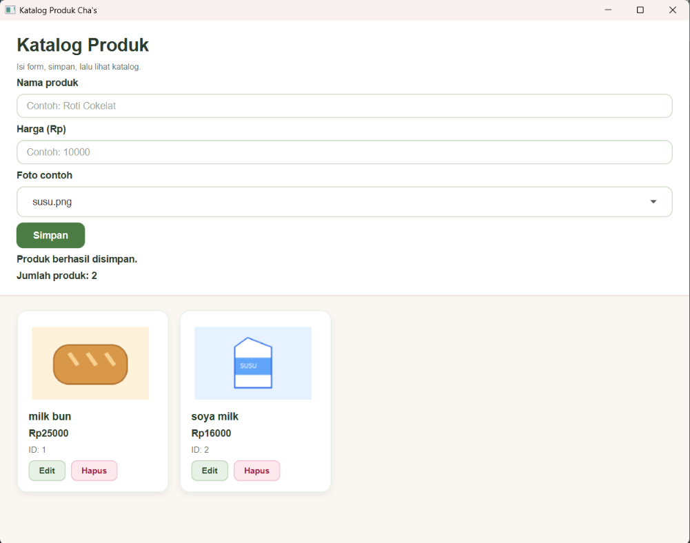
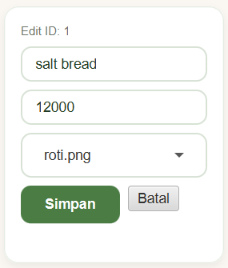
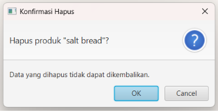

# Katalog Produk App

Aplikasi desktop katalog produk berbasis **JavaFX**, **Maven**, dan **SQLite**. Pengguna dapat menambahkan produk beserta foto, melihatnya dalam bentuk kartu katalog, mengubah data langsung di kartu, dan menghapusnya. Data tersimpan permanen di database SQLite, sehingga tidak hilang saat aplikasi ditutup.

## Fitur Utama

- **Tambah Produk**: Form untuk mengisi nama produk, harga (Rp), dan foto contoh yang dipilih dari daftar (`roti.png`, `susu.png`, `kopi.png`).
- **Katalog Berbentuk Kartu**: Setiap produk tampil sebagai kartu berisi foto, nama, harga, dan ID. Kartu tersusun otomatis mengikuti lebar jendela dan bisa digulir (scroll) saat produk banyak. Jumlah produk ditampilkan di bagian atas.
- **Edit Langsung di Kartu**: Tombol **Edit** mengubah kartu menjadi form (nama, harga, foto) dengan tombol **Simpan** dan **Batal**, tanpa berpindah halaman.
- **Hapus dengan Konfirmasi**: Tombol **Hapus** menampilkan dialog konfirmasi sebelum produk dihapus.
- **Penyimpanan Permanen (SQLite)**: Data disimpan di file `data/katalog.db`. File dan tabel dibuat otomatis saat aplikasi pertama kali dijalankan.
- **Validasi Input & Penanganan Eksepsi**:
  - Nama produk tidak boleh kosong.
  - Harga harus bilangan bulat lebih dari nol (`NumberFormatException` dan `IllegalArgumentException` ditangani dengan pesan di layar).
  - Foto produk wajib dipilih.
  - Aturan yang sama juga dijaga di tingkat database lewat `CHECK` constraint.
  - Kesalahan database (`SQLException`) ditampilkan sebagai pesan singkat di layar, dan rinciannya dicetak di jendela Output.

## Teknologi

- Java 17 dan JavaFX 21 (`javafx-controls`, `javafx-fxml`)
- Maven (dengan `javafx-maven-plugin`)
- SQLite lewat JDBC (`sqlite-jdbc` 3.49.1.0)
- CSS untuk tampilan (`app.css`)
- Apache NetBeans IDE

## Kebutuhan

- JDK 17 atau lebih baru
- Apache NetBeans IDE (sudah termasuk Maven)
- Koneksi internet saat build pertama, agar Maven mengunduh dependensi JavaFX dan SQLite

## Cara Menjalankan

1. Clone repository:
   ```
   git clone https://github.com/chaavier/Katalog-App.git
   ```
   (Membutuhkan Git. Alternatifnya, klik tombol **Code > Download ZIP** di halaman repository, lalu ekstrak.)

2. Buka Apache NetBeans IDE, lalu pilih menu **File > Open Project...** dan arahkan ke folder proyek `KatalogProduk`.

3. Klik kanan pada nama proyek di panel **Projects**, lalu pilih **Clean and Build** (`Shift + F11`) agar Maven mengunduh seluruh dependensi.

4. Untuk menjalankan aplikasi, klik kanan pada nama proyek, lalu pilih **Run** (atau tekan `F6`).

5. **Alternatif lewat terminal** (membutuhkan Maven terpasang): buka terminal di folder proyek, lalu jalankan `mvn clean javafx:run`.

**Catatan lokasi database:** file `data/katalog.db` dibuat relatif terhadap folder tempat aplikasi dijalankan. Jalankan dari folder proyek (otomatis jika memakai NetBeans) agar database berada di folder `data/` milik proyek. Lokasi database yang aktif dicetak di jendela Output dengan awalan `DATABASE AKTIF:`.

## Cara Menggunakan

1. Isi **Nama produk** dan **Harga (Rp)**, pilih **Foto contoh**, lalu klik **Simpan**. Produk langsung muncul sebagai kartu di katalog.
2. Untuk mengubah produk, klik **Edit** pada kartunya, ubah nama, harga, atau foto, lalu klik **Simpan**. Klik **Batal** untuk membatalkan.
3. Untuk menghapus produk, klik **Hapus** pada kartunya, lalu konfirmasi pada dialog yang muncul.

## Screenshot

<p align="center">
  <br>
  <em>Gambar 1. Halaman katalog dengan form tambah produk.</em>
</p>

<p align="center">
  <br>
  <em>Gambar 2. Mode edit langsung pada produk.</em>
</p>

<p align="center">
  <br>
  <em>Gamber 3. Halaman konfirmasi saat menghapus produk.</em>
</p>

## Struktur Database

Tabel `produk`:

| Kolom | Tipe | Aturan |
|---|---|---|
| `id` | INTEGER | Primary key, dibuat otomatis |
| `nama` | TEXT | Wajib diisi, tidak boleh kosong |
| `harga` | INTEGER | Wajib diisi, harus lebih dari 0 |
| `foto` | TEXT | Wajib diisi, nama file gambar |

## Struktur Proyek

```
KatalogProduk/
├── pom.xml
├── nbactions.xml
├── data/
│   └── katalog.db                    # database SQLite (dibuat otomatis)
└── src/main/
    ├── java/
    │   ├── main/MainApp.java         # titik masuk aplikasi
    │   ├── controller/KatalogController.java
    │   ├── data/ProdukRepository.java  # operasi tambah, baca, ubah, hapus
    │   ├── db/Database.java          # koneksi dan pembuatan tabel
    │   └── model/Produk.java         # data produk dan validasinya
    └── resources/
        ├── image/                    # roti.png, susu.png, kopi.png
        └── view/
            ├── katalog.fxml
            └── styles/app.css
```

## Catatan

- Pilihan foto terbatas pada tiga gambar bawaan di `src/main/resources/image/`. Untuk menambah gambar, simpan filenya di folder itu lalu daftarkan namanya pada method `initialize()` di `KatalogController`.
- Data yang dihapus tidak dapat dikembalikan.
- Pada saat pertama dijalankan, katalog akan kosong karena database dibuat otomatis. Tambahkan produk lewat form untuk mulai menggunakannya.


